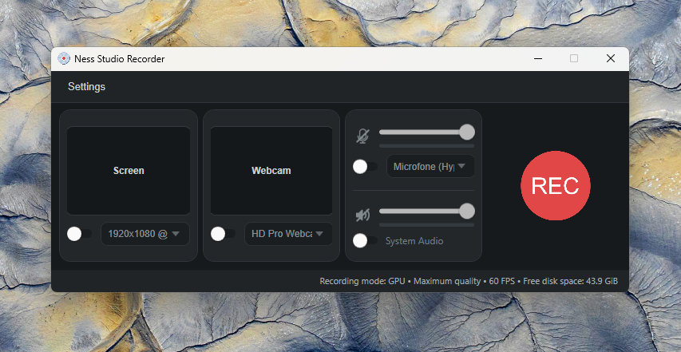
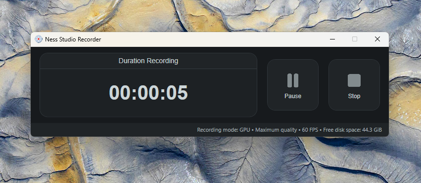

<p align="center">
  
</p>

<h1 align="center">
  NessStudio For Windows (3.0.0 Beta)
</h1>

<p align="center">
  Capture everything in high quality :)
</p>

<p align="center">
  <a href="https://micilini.com/apps/nessstudio" target="_blank">
    
  </a>
</p>

[](https://dotnet.microsoft.com/)
[](https://www.microsoft.com/windows)
[](https://learn.microsoft.com/en-us/dotnet/desktop/wpf/)
[](native/libnessstudio/README.md)
[](https://github.com/micilini/NessMuxer)
[](https://ffmpeg.org/)
[](https://github.com/micilini/NessStudio/blob/main/LICENSE)
[](https://github.com/micilini/NessStudio/releases)
[](https://github.com/micilini/NessStudio/releases)

---

> ⚠️ **Public Beta**
>
> NessStudio 3.0.0 moves capture, processing, encoding, and recording lifecycle into **libnessstudio**, a native engine with a public C ABI. The WPF application controls the engine through .NET 10 interop, with independent tracks, live previews, scene recording, recovery metadata, and FFmpeg media jobs.

---

# NessStudio

**NessStudio** is a Windows-native recording application capable of capturing your screen, webcam, microphone, and system audio.

It is ideal for tutorials, classes, onboarding, technical support, product demos, software demonstrations, gameplay clips, and quick everyday recordings.

## Highlights

- **Native recording engine:** [libnessstudio](native/libnessstudio/README.md) owns screen, webcam, microphone, and system audio capture behind a public C ABI.
- **Native encoding and muxing:** [NessMuxer](https://github.com/micilini/NessMuxer) is statically linked into the engine, with Intel Quick Sync, NVIDIA NVENC, AMD AMF, and CPU x264 routes.
- **Independent capture channels:** screen, webcam, microphone, and system audio can be recorded alone or together.
- **Draw Area support:** capture a full monitor or a custom screen region, with cursor capture.
- **Draw Area overlay:** custom-region recordings display a visual capture overlay while recording.
- **Live previews and scenes:** independent screen/webcam previews, composed scenes, and optional `program.mkv` output.
- **Pause / Resume:** pause and continue active sessions through a shared native session clock.
- **Session metadata and recovery:** project manifests, per-track metadata, and recovery checkpoints preserve recording state and finalized assets.
- **Recording thumbnails:** previews are generated from the available primary, program, screen, or webcam video asset.
- **Project library:** recent recordings can be opened, exported, or deleted from the home screen.
- **FFmpeg export:** generate final MP4, MKV, MP3, WAV, or separated editing tracks from a recording session.
- **Diagnostics:** optional debug logs and separate error logs help troubleshoot recording and export failures.

## Application Images

<div style="display:flex;flex-wrap:wrap;gap:10px;justify-content:center;">
  <div style="flex:1 1 220px;max-width:32%;aspect-ratio:16/9;overflow:hidden;border-radius:8px;">
    
  </div>
  <div style="flex:1 1 220px;max-width:32%;aspect-ratio:16/9;overflow:hidden;border-radius:8px;">
    
  </div>
  <div style="flex:1 1 220px;max-width:32%;aspect-ratio:16/9;overflow:hidden;border-radius:8px;">
    
  </div>
  <div style="flex:1 1 220px;max-width:32%;aspect-ratio:16/9;overflow:hidden;border-radius:8px;">
    
  </div>
</div>

## Recording Sources

A recording session may contain one or more of these tracks:

| Source | Output |
|---|---|
| Screen | `screen.mkv` |
| Webcam | `webcam.mkv`, also remuxed to `webcam.mp4` during finalization |
| Microphone | `mic.wav` |
| System audio | `system.wav` |
| Composed scene | `program.mkv` when scene recording is enabled |
| Finalized audio/video output | `final.mkv` when audio sources are included |
| Metadata | `manifest.json`, `session.manifest.json`, and native track/session records |
| Preview | `preview.png` when a video track exists |

Files depend on the selected sources and recording mode. Native screen and camera tracks use Matroska, and audio tracks use WAV. Audio-only sessions are supported; they do not generate a visual preview.

## Export Options

NessStudio 3.0.0 exports through native media jobs and the pinned FFmpeg runtime, using the project manifest and session timing.

### Single File

Create one shareable file from selected video and audio sources.

Supported video layouts:

| Layout | Description |
|---|---|
| No video · Audio only | Exports only the selected audio tracks |
| Screen only | Exports the screen track |
| Webcam only | Exports the webcam track |
| Recorded program | Exports the composed scene recorded in `program.mkv` |
| Screen + Webcam · Picture-in-picture | Places webcam over the screen |
| Screen + Webcam · Side by side | Places screen and webcam next to each other |

Supported audio modes:

| Mode | Description |
|---|---|
| No audio | Exports video without audio |
| Microphone only | Uses only `mic.wav` |
| System audio only | Uses only `system.wav` |
| Microphone + System audio | Mixes both audio tracks |

Supported containers:

| Container | Use case |
|---|---|
| MP4 | Recommended video export |
| MKV | Video export with Matroska container |
| MP3 | Audio-only export |
| WAV | Audio-only lossless export |

Supported quality presets:

| Type | Presets |
|---|---|
| Video | Fast, Balanced, High quality |
| MP3 | 128 kbps, 192 kbps, 320 kbps |
| WAV | 44.1 kHz / 16-bit, 48 kHz / 16-bit, 48 kHz / 24-bit |

### Separate Tracks

Export synchronized editing assets into a folder:

| Output | Description |
|---|---|
| `screen.mp4` | Screen track converted/copied for editing |
| `webcam.mp4` | Webcam track copied for editing |
| `program.mp4` | Recorded scene, when available and selected |
| `microphone.wav` | Independent microphone audio, when selected |
| `system.wav` | Independent system audio, when selected |
| `audio_mix.wav` | Mixed microphone/system audio |

Completed export files are decoded for validation and receive an `.export.json` receipt. Export offers **Open Folder** beside **Browse** and opens the destination after successful validation.

## Architecture Overview

```text
WPF application (.NET 10)
  └─ NessStudio.Core + NessStudio.Infrastructure
     └─ NessStudio.Interop (public C ABI)
        └─ libnessstudio.dll
           ├─ Screen / camera / microphone / system audio capture
           ├─ D3D11 / CPU processing, scenes, and live previews
           ├─ NessMuxer (static) → H.264 / MKV video tracks
           ├─ Native audio writer → WAV microphone / loopback tracks
           ├─ Shared session clock, commands/events, and recovery journals
           └─ Native media jobs → FFmpeg finalization, thumbnails, and exports

Project manifests  → manifest.json + session.manifest.json
Native metadata    → track manifests + recording-native.json + operation journals
Project library    → preview.png + local SQLCipher database
```

The application sends commands and consumes events, snapshots, and preview frames through **libnessstudio**. The engine exposes a C ABI and implements capture, processing, encoding, and recording lifecycle using C++20 and native Windows APIs.

[NessMuxer](https://github.com/micilini/NessMuxer) is the engine's statically linked encoding/muxing dependency. MSBuild stages `libnessstudio.dll` and its runtime dependencies beside `NessStudio.exe`. FFmpeg runs through explicit native jobs for finalization, thumbnail generation, and exports.

## What Changed Since Version 2.0.0

Version 3.0.0 moves the recording pipeline into a native engine and upgrades the application to .NET 10.

### Native Recording Engine

- Added `libnessstudio.dll` with a public C ABI for capture, processing, encoding, previews, sessions, and media jobs.
- Replaced the managed recording pipeline with native screen, DirectShow camera, and WASAPI audio capture controlled through .NET interop.
- Integrated NessMuxer statically into libnessstudio for H.264 encoding and Matroska muxing.
- Added capability-based Intel Quick Sync, NVIDIA NVENC, AMD AMF, and CPU x264 encoder selection.
- Added Automatic, GPU hardware, GPU capture with software encoding, and Full Software execution policies, with the effective route stored in recording metadata.

### Recording Modes and Live Previews

- Kept independent screen, webcam, microphone, and system audio tracks, including audio-only sessions.
- Added separate-source, composed-program, and program-plus-source recording modes.
- Added scene composition and `program.mkv` for recorded layouts.
- Added independent live screen/webcam previews and native CPU/GPU presentation paths.
- Kept monitor/Draw Area selection, cursor capture, and pause/resume through a shared native clock.

### Session Manifests and Recovery

- Added project manifest schema 3 with asset roles, timing, native route selection, scene metadata, and finalization state.
- Preserved `manifest.json` and `session.manifest.json` aliases and support for existing version 2 project manifests.
- Added native track manifests, recording snapshots, operation journals, and recovery checkpoints.
- Added recovery of finalized, revalidated media into a new project while preserving original assets and interrupted outputs.
- Added project registration records so a completed recording can be registered again if saving to the library was interrupted.

### Project Library, Export, and Diagnostics

- Moved finalization, thumbnails, and exports into supervised native jobs using the pinned FFmpeg runtime.
- Added recorded-program export and optional independent microphone/system audio editing tracks.
- Added output decoding and completion receipts for successful exports.
- Added **Open Folder** controls and automatic destination opening after export validation.
- Kept the compact four-card recorder with independent previews and refreshed recording/project controls.
- Moved new recording workspaces to `%LOCALAPPDATA%\NessStudio\Recordings`, while preserving existing project locations.
- Added a hash-verified SQLCipher database runtime and reproducible dependency staging.
- Kept detailed recording diagnostics behind **Enable Debug Logs**, with failures written to a separate error log.

### Project Structure

- `src/NessStudio.App`: WPF screens, view models, application composition, and preview presentation.
- `src/NessStudio.Core`: shared domain models and recording contracts.
- `src/NessStudio.Infrastructure`: native recording orchestration, project storage/recovery, database, and export services.
- `src/NessStudio.Interop`: native ABI declarations, handle ownership, and managed engine/session/job wrappers.
- `native/libnessstudio`: engine implementation and public C header; `native/nessstudio-cli`: command-line host.
- `native/tests` and `tests`: native tests and managed ABI, recording, project, and UI probes.
- `cmake`: native builds, pinned runtime restoration, staging, and dependency notice verification.
- The WPF application, infrastructure, and interop projects target `net10.0-windows10.0.19041.0`; the shared Core library targets `net10.0`. Native presets target Windows x64.

## How to Run Locally

**Requirements:**

- Windows 10 build 19041 or newer / Windows 11, x64
- [Visual Studio Community 2026 or newer](https://learn.microsoft.com/en-us/dotnet/core/install/windows), with the **.NET desktop development** and **Desktop development with C++** workloads
- .NET 10 SDK matching [`global.json`](global.json)
- v145 x64 C++ toolset, CMake, and Windows SDK 10.0.26100.0 for the checked-in native build preset
- Git, PowerShell, and internet access for NuGet and the first FFmpeg restore

**Steps:**

1. In a PowerShell terminal, clone the repository:

   ```powershell
   git clone https://github.com/micilini/NessStudio.git
   cd NessStudio
   ```

2. Restore the pinned FFmpeg runtime:

   ```powershell
   powershell -NoProfile -ExecutionPolicy Bypass -File cmake/Restore-MediaTools.ps1
   ```

3. Open `NessStudio.sln` in Visual Studio and select `NessStudio.App` as the startup project.
4. Select the **x64** platform and build the solution. MSBuild builds `libnessstudio.dll` and stages it with the x264/C++ runtime dependencies beside `NessStudio.exe`; SQLCipher and `Native/FFmpeg/ffmpeg.exe` are also copied automatically.
5. Run the application with `F5`.

NessMuxer is statically linked into `libnessstudio.dll`. The V3 application loads this engine directly, with its matching runtime files. Framework-dependent published packages require the **.NET 10 Desktop Runtime**; the Standalone package includes it.

## Development Guide

See the [Development Guide](DEVELOPMENT.md) for build/publish commands, native DLL generation and deployment, automated verification, the repository layout, and database runtime rebuilding.

## Generated Recording Folder Example

Example of a finalized recording with all four sources and optional exports:

```text
recording/
├─ screen.mkv
├─ screen.mkv.manifest.json
├─ screen.mkv.session-<id>.json
├─ webcam.mkv
├─ webcam.mkv.manifest.json
├─ webcam.mp4
├─ webcam.mp4.export.json
├─ mic.wav
├─ system.wav
├─ final.mkv
├─ final.mkv.export.json
├─ manifest.json
├─ session.manifest.json
├─ recording-native.json
├─ native-camera-export.json
├─ native-export.json
├─ project-recovery.json
├─ project-registration.json
├─ preview.png
├─ preview.png.thumbnail.json
└─ Exports/
   ├─ recording_export.mp4
   ├─ recording_export.mp4.export.json
   └─ recording_tracks/
      ├─ screen.mp4
      ├─ webcam.mp4
      └─ audio_mix.wav
```

Scene modes can also write `program.mkv` and `program.mkv.manifest.json`; audio-only sessions use `audio.native.json`. Native jobs add `*.job-<id>.json` journals, and each exported track has its own `.export.json` receipt. IDs and files vary with the selected sources, recording mode, and completed operations.

Interrupted operations can leave `.pending` or partial files and `recording-incomplete.json`. Recovery may also write `recovery-result.json` and a `recovered-*` directory. These records preserve evidence and original assets; unfinished media is not automatically certified as recovered.

## What V3 Does

- Record a monitor or a selected screen region, with cursor capture.
- Record a webcam, microphone, and system audio independently or together, including audio-only sessions.
- Keep separate source tracks or record a composed scene, with screen/camera layouts and previews.
- Pause and resume through a shared session clock; write manifests and recovery checkpoints for interrupted recordings.
- Encode H.264 through Intel Quick Sync, NVIDIA NVENC, AMD AMF, or CPU x264, according to the selected policy and actual device capabilities.
- Provide explicit GPU, GPU capture with software encoding, and full software modes. Automatic mode can select a software route when hardware capabilities are unavailable; invalid configurations and driver failures remain visible errors.
- Manage recorded projects, generate thumbnails, and export video, audio, or separate editing tracks using the pinned FFmpeg runtime.

New recording workspaces are stored in `%LOCALAPPDATA%\NessStudio\Recordings`. Detailed diagnostics are written to `%LOCALAPPDATA%\NessStudio\Logs\recording-debug.log` only while **Enable Debug Logs** is checked in About. Disabling it stops new diagnostic entries without deleting existing logs. Failures are recorded separately in `recording-errors.log`.

Existing projects retain their original locations, and recovery also checks the former `Documents\NessStudio\Recordings` folder. Recovery copies finalized, revalidated assets into a new project; it does not certify unfinished MKV/WAV tails.

The application and capture engine currently target **Windows x64**. Hardware encoding requires a compatible device and driver; a GPU brand alone does not guarantee encoder availability. Linux and macOS capture backends are not implemented in libnessstudio. NessMuxer is a separate project with its own platform support. A successful build does not certify every camera, driver, GPU, or recording duration.

## Built With

- C# 14 / .NET 10
- Windows Presentation Foundation (WPF)
- libnessstudio — native recording engine with a public C ABI and C++20 implementation
- Native Windows APIs — D3D11 processing/previews, DirectShow cameras, and WASAPI audio
- NessMuxer — statically linked encoding/muxing backend with Quick Sync, NVENC, AMF, and x264
- SQLCipher / SQLite — local project database with a pinned native runtime
- FFmpeg — native jobs for finalization, thumbnails, and exports
- NAudio — managed WAV metadata helpers
- MaterialDesignThemes / MaterialDesignColors — WPF UI components

## Version History

### Version 3.0.0 Beta — Native Recording Engine

NessStudio is a Windows recording application for screens, webcams, microphones, and system audio. Version 3 moves capture, processing, encoding, and recording lifecycle into **libnessstudio**, a native library with a public C ABI. The WPF application controls the engine through .NET 10 interop.

Adds capability-based Quick Sync/NVENC/AMF/x264 encoding, explicit GPU/software policies, independent live previews, composed scenes and program tracks, shared-clock sessions, project manifest schema 3, operation journals, and recovery of finalized media. Finalization, thumbnails, and MP4/MKV/MP3/WAV exports run through native jobs using the pinned FFmpeg runtime.

Updates the recording/project controls, recording storage and diagnostic logs, SQLCipher runtime verification, and reproducible native SDK/application packaging. The product remains a public beta for Windows x64.

### Version 2.0.0 Beta

Major recording architecture, export, sync, and UI update. Adds independent tracks, WGC/NessMuxer screen recording, manifest v2, master session clock, Draw Area overlay, FFmpeg export window, audio-only export, separate tracks export, and refreshed application screens.

### Version 1.1.0

Introduced the native recording direction using Windows Graphics Capture and NessMuxer, replacing the old FFmpeg-first recording approach and improving session metadata/control.

### Version 1.0.0

Initial public version. Provided Windows screen, webcam, microphone, and system audio recording with simple project/session output and FFmpeg-based workflow.

## Contributing

Want to create new features for **NessStudio**? Create a new feature branch and submit a Pull Request. Feel free to open issues for bug fixes, improvements, or feature requests.

## Licenses and Redistributions

NessStudio's own source is covered by the [MIT License](LICENSE). Bundled components retain their own licenses, including x264/FFmpeg GPL terms and the notices for SQLCipher, OpenSSL, SDK headers, and managed packages. The native staging and publish steps preserve these notices and the supplied x264 source archive. The MIT license does not override the redistribution requirements of bundled dependencies.

Keep the complete published package together, including native runtime files, `Native/FFmpeg`, dependency notices, and source material supplied by the build. See [`licenses/third-party`](licenses/third-party) and the [Development Guide](DEVELOPMENT.md#build-the-app) for packaging details.
